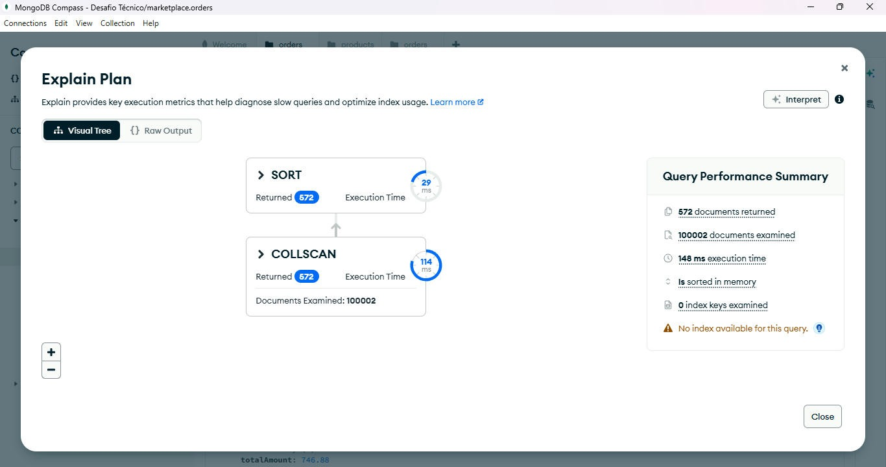
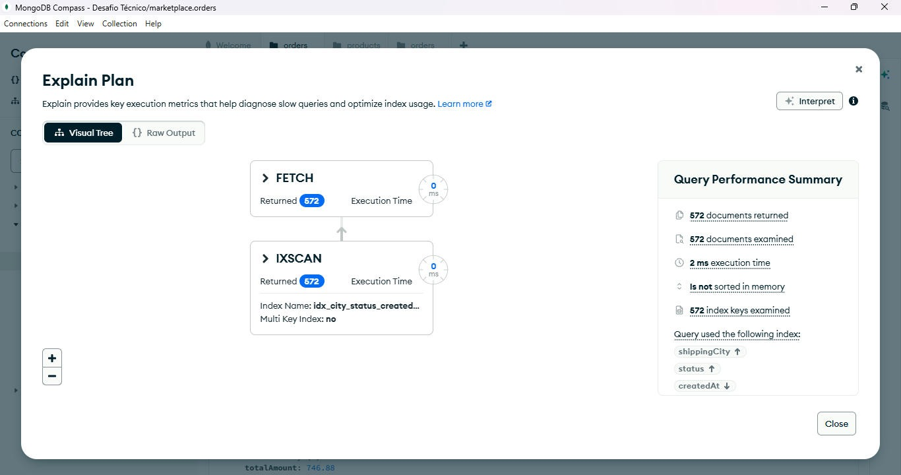
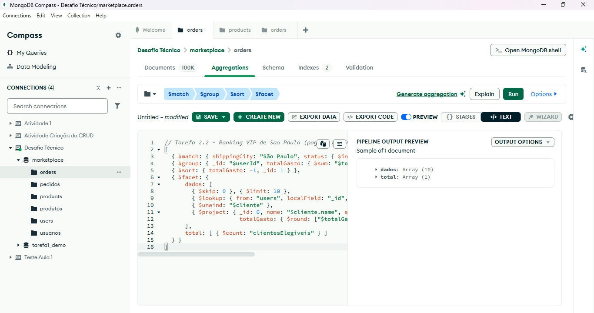
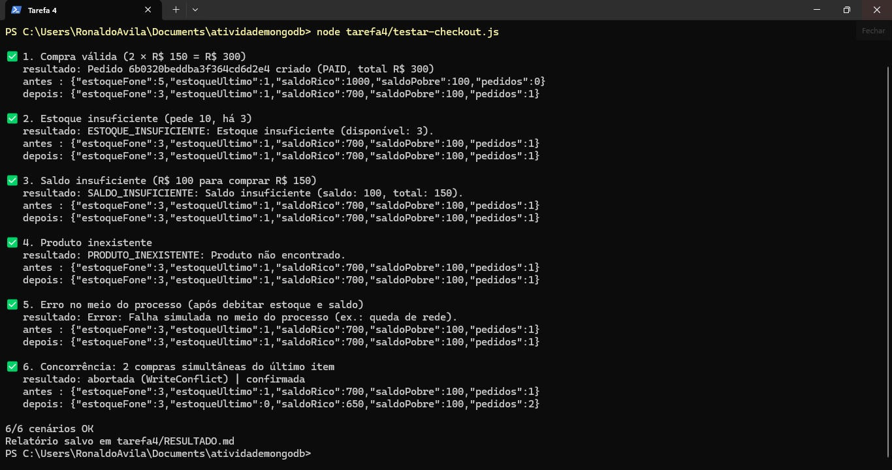

# Desafio Técnico Back-End: Engenharia de Dados com MongoDB

**Aluno:** Ronaldo de Ávila Ribeiro Júnior

Projeto da disciplina **Banco de Dados Não Relacional**. Ele reúne as 8 etapas do desafio: uma API de marketplace que evolui da memória para o MongoDB, um seed com 100 mil pedidos, modelagem de schema, Aggregation Framework, otimização com índices e transações ACID.

**Stack:** Node.js · Express 5 · MongoDB 9 (replica set) · Mongoose · driver oficial `mongodb` · MongoDB Compass

---

## Etapas

| # | Etapa | Código | Resultado / Relatório |
|---|---|---|---|
| 1 | **Parte 1** — API REST em memória | [`parte1/index.js`](parte1/index.js) | — |
| 2 | **Parte 2** — Testar a API | [`parte2/testar-api.js`](parte2/testar-api.js) | [`RESULTADO.md`](parte2/RESULTADO.md) · [PDF](relatorios_simples/Relatorio_Parte2.pdf) |
| 3 | **Parte 3** — Persistência com MongoDB (Mongoose) | [`parte3/index.js`](parte3/index.js) | [`RESULTADO.md`](parte3/RESULTADO.md) · [PDF](relatorios_simples/Relatorio_Parte3.pdf) |
| 4 | **Parte 4** — Script de seed (100 mil pedidos) | [`parte4/seed.js`](parte4/seed.js) | [`AMOSTRA.md`](parte4/AMOSTRA.md) · [PDF](relatorios_simples/Relatorio_Parte4.pdf) |
| 5 | **Tarefa 1** — Modelagem e evolução de schema | [`tarefa1/demo.js`](tarefa1/demo.js) | [`SOLUCAO.md`](tarefa1/SOLUCAO.md) · [PDF](relatorios_simples/Relatorio_Tarefa1.pdf) |
| 6 | **Tarefa 2** — Aggregation Framework | [`tarefa2/pipelines.js`](tarefa2/pipelines.js) | [`RELATORIO.md`](tarefa2/RELATORIO.md) · [PDF](relatorios_simples/Relatorio_Tarefa2.pdf) |
| 7 | **Tarefa 3** — Diagnóstico e otimização (índices) | [`tarefa3/otimizar.js`](tarefa3/otimizar.js) | [`SOLUCAO.md`](tarefa3/SOLUCAO.md) · [PDF](relatorios_simples/Relatorio_Tarefa3.pdf) |
| 8 | **Tarefa 4** — Consistência e transações ACID | [`tarefa4/checkout.js`](tarefa4/checkout.js) | [`RESULTADO.md`](tarefa4/RESULTADO.md) · [PDF](relatorios_simples/Relatorio_Tarefa4.pdf) |

Cada relatório em PDF (e o `.docx` equivalente em [`relatorios_simples/`](relatorios_simples)) traz a explicação, os resultados e, no final, os **prints reais da execução** no MongoDB Compass e no terminal. Os prints estão em [`evidencias/`](evidencias).

---

## Resumo de cada etapa

### Parte 1 — API em memória
API Express com repositórios em memória para **usuários** (vendedor/comprador), **produtos** e **pedidos**. Ela valida as regras de negócio: só vendedor anuncia, a compra exige estoque e o pedido baixa o estoque. Os erros voltam como HTTP 400, 403 ou 404 com mensagem.

Rotas: `POST/GET /usuarios`, `POST/GET /produtos`, `GET /produtos/:id`, `POST/GET /pedidos`.

### Parte 2 — Teste da API
O script executa o fluxo completo: cria vendedor, comprador e produto, consulta a vitrine e faz uma compra de 2 unidades, que leva o **estoque de 5 para 3**. Depois testa dois casos de erro: estoque insuficiente e comprador tentando anunciar. O relatório é gerado automaticamente.

### Parte 3 — Persistência com MongoDB
É a mesma API, agora com **Mongoose**. A aplicação conecta antes de abrir a porta, valida `ObjectId` e baixa o estoque de forma **atômica** com `findOneAndUpdate({ _id, estoque: { $gte: qtd } }, { $inc: { estoque: -qtd } })`, o que impede estoque negativo mesmo com compras simultâneas. O pedido guarda o `precoUnitario` do momento da compra.

### Parte 4 — Seed
Popula o banco `marketplace` com **5.000 usuários, 1.000 produtos e 100.000 pedidos** (com itens, categorias, cidades e status variados) em poucos segundos. Usa `insertMany` em lotes com `ordered: false` e apaga só as coleções do seed, não o banco inteiro.

### Tarefa 1 — Modelagem
- **Avaliações:** padrão *Subset + Computed*. O produto guarda um `ratingSummary` (contagem, soma e média) e as **10 avaliações mais recentes**, mantidas com `$push` + `$each` + `$position: 0` + `$slice: 10`. As avaliações completas ficam na coleção `reviews`.
- **Auditoria de pedidos:** `statusHistory` embutido no pedido. Cada transição registra de/para, data e responsável, e só é aceita se o status atual for o esperado.

### Tarefa 2 — Aggregation Framework
- **Faturamento por categoria (90 dias):** `$match → $unwind → $group → $project → $sort`. A primeira categoria é *Casa e Cozinha*, com R$ 8.296.986,18.
- **Ranking VIP de São Paulo, paginado:** `$facet` devolve na mesma consulta a página (`$skip`/`$limit` + `$lookup` em `users`) e o total de **846 clientes elegíveis**.

### Tarefa 3 — Índices e `explain()`
Consulta: pedidos `DELIVERED` de São Paulo nos últimos 30 dias, ordenados por data. O índice composto segue a regra **ESR** (Equality, Sort, Range):

```js
db.orders.createIndex({ shippingCity: 1, status: 1, createdAt: -1 }, { name: "idx_city_status_createdAt_ESR" })
```

| | Antes | Depois |
|---|---:|---:|
| Plano | `SORT → COLLSCAN` | `FETCH → IXSCAN` |
| Documentos examinados | 100.002 | **572** |
| Documentos retornados | 572 | 572 |
| Ordenação em memória | sim | **não** |
| Tempo | 86 ms | **1 ms** |

### Tarefa 4 — Transações ACID
Checkout com `session.startTransaction()` (read concern *snapshot*, write concern *majority*). Ele valida produto, estoque e saldo, baixa o estoque, debita a carteira e cria o pedido `PAID`. Se qualquer passo falhar, `abortTransaction()` desfaz tudo. Os **6 cenários testados passaram (6/6)**: compra válida, estoque insuficiente, saldo insuficiente, produto inexistente, erro no meio do processo (rollback) e duas compras simultâneas do último item (uma confirma e a outra é abortada com `WriteConflict`).

---

## Como executar

### Pré-requisitos
- **Node.js 18+**. Na raiz do projeto, rode `npm install`.
- **MongoDB em replica set**, porque as transações da Tarefa 4 não funcionam em instância standalone. Exemplo local:

```powershell
mongod --replSet rs0 --port 27018 --bind_ip 127.0.0.1 --dbpath .\data\rs0 --logpath .\logs\mongod-rs0.log
# só na primeira vez:
mongosh --port 27018 --eval "rs.initiate({_id:'rs0', members:[{_id:0, host:'127.0.0.1:27018'}]})"
```

- Copie `.env.example` para `.env` e ajuste `MONGO_URI` se necessário:

```
MONGO_URI=mongodb://127.0.0.1:27018/marketplace?replicaSet=rs0
PORT=3000
```

### Comandos

| Etapa | Comando |
|---|---|
| Parte 1 | `npm run parte1` (API em http://localhost:3000) |
| Parte 2 | com a Parte 1 rodando: `npm run parte2` |
| Parte 3 | `npm run parte3`, depois `node parte2/testar-api.js http://localhost:3000 parte3/RESULTADO.md` |
| Parte 4 | `npm run seed` |
| Tarefa 1 | `npm run tarefa1` |
| Tarefa 2 | `npm run tarefa2` (página: `node tarefa2/pipelines.js 2 10`) |
| Tarefa 3 | `npm run tarefa3` |
| Tarefa 4 | `npm run tarefa4` |

Rode o seed (Parte 4) antes das Tarefas 2, 3 e 4. Cada script grava o próprio relatório `.md` na pasta da etapa.

---

## Estrutura

```
├── parte1/            API Express em memória
├── parte2/            teste automatizado da API + RESULTADO.md
├── parte3/            API com Mongoose + RESULTADO.md
├── parte4/            seed (100 mil pedidos) + AMOSTRA.md
├── tarefa1/           modelagem (reviews + statusHistory) + SOLUCAO.md
├── tarefa2/           pipelines de agregação + RELATORIO.md
├── tarefa3/           explain + índice ESR + SOLUCAO.md
├── tarefa4/           checkout transacional + testes + RESULTADO.md
├── relatorios_simples/ relatórios finais em PDF e Word
├── evidencias/        prints do MongoDB Compass e do terminal
├── scripts/           geração dos relatórios (Word/PDF) e utilitários
└── gerar-entregas.ps1 empacota cada etapa em .zip para envio
```

## Evidências (amostra)

| Tarefa 3 — antes (COLLSCAN) | Tarefa 3 — depois (IXSCAN) |
|---|---|
|  |  |

| Tarefa 2 — Ranking VIP com `$facet` | Tarefa 4 — 6 cenários da transação |
|---|---|
|  |  |
